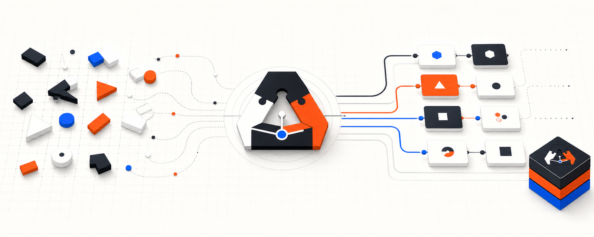
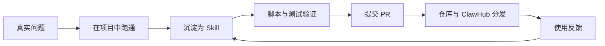

<p align="center">
  <a href="https://clawhub.ai/rfdiosuao">
    
  </a>
</p>

<h1 align="center">AgentSkill</h1>

<p align="center">把解决过一次的问题，沉淀成可以反复调用的 Agent Skill。</p>

<p align="center">
  <a href="LICENSE"></a>
  <a href="https://github.com/rfdiosuao/AgentSkill/stargazers"></a>
  <a href="https://github.com/rfdiosuao/AgentSkill/forks"></a>
  <a href="https://github.com/rfdiosuao/AgentSkill/issues"></a>
  <a href="https://github.com/rfdiosuao/AgentSkill/pulls"></a>
  <a href="https://github.com/rfdiosuao/AgentSkill/commits/main"></a>
</p>

<p align="center">
  <a href="#快速开始">快速开始</a> ·
  <a href="#skill-目录">Skill 目录</a> ·
  <a href="https://clawhub.ai/rfdiosuao">ClawHub</a> ·
  <a href="CONTRIBUTING.md">贡献 Skill</a> ·
  <a href="https://github.com/rfdiosuao/AgentSkill/issues/new?template=skill-request.yml">提交需求</a>
</p>

<a href="https://github.com/rfdiosuao/AgentSkill">
  
</a>

AgentSkill 是一个面向 OpenClaw、Codex 和通用 AI Agent 工作流的中文 Skill 仓库。这里不收集空泛提示词，每个 Skill 都应来自真实任务，并尽量带上边界说明、参考资料、脚本或测试。

> 仓库的增长路径：解决真实问题，跑通一次，把过程固化为 Skill，再通过验证、PR 和 ClawHub 继续分发。

## 从这里开始

| 你想完成的事 | 推荐入口 | 交付形态 |
| --- | --- | --- |
| 优化 GitHub 仓库首页 | [`craft-repository-readme`](craft-repository-readme/) | `SKILL.md`、版式参考、README 校验脚本 |
| 配置飞书多 Agent | [`feishu-multi-agent-manager`](feishu-multi-agent-manager/) | 完整源码、测试、ClawHub 版本 |
| 诊断 OpenClaw 网络 | [`openclaw-network-optimizer`](openclaw-network-optimizer/) | 完整源码、网络快照脚本、回滚流程 |
| 下载历史发布包 | [仓库归档](#仓库归档) | 可离线检查的 `tar.gz` 快照 |
| 提议一个新 Skill | [Skill request](https://github.com/rfdiosuao/AgentSkill/issues/new?template=skill-request.yml) | 可讨论、可追踪的需求单 |

## 快速开始

### 从源码安装一个 Skill

下面以刚加入仓库的 README 优化 Skill 为例。OpenClaw 支持从本地 Skill 目录安装：

```bash
git clone https://github.com/rfdiosuao/AgentSkill.git
cd AgentSkill
openclaw skills install ./craft-repository-readme --as craft-repository-readme
```

Codex 用户也可以把该目录复制到个人 Skills 目录：

```bash
mkdir -p "${CODEX_HOME:-$HOME/.codex}/skills"
cp -R craft-repository-readme "${CODEX_HOME:-$HOME/.codex}/skills/"
```

<details>
<summary>Windows PowerShell</summary>

```powershell
Copy-Item -Recurse .\craft-repository-readme "$HOME\.codex\skills\craft-repository-readme"
```

</details>

安装后可以直接描述任务，例如：

```text
使用 craft-repository-readme 审计并优化当前仓库，核对真实功能，补齐主视觉、快速开始和发布校验。
```

### 从 ClawHub 安装

安装社区 Skill 前，建议先查看 Skill Card 和安全扫描：

```bash
openclaw skills verify @rfdiosuao/feishu-multi-agent-manager --card
openclaw skills install @rfdiosuao/feishu-multi-agent-manager
```

更多命令以 [OpenClaw Skills 官方文档](https://docs.openclaw.ai/skills) 为准。

## Skill 目录

### 仓库源码

| Skill | 适合解决的问题 | 关键内容 |
| --- | --- | --- |
| [`craft-repository-readme`](craft-repository-readme/) | README 审计、重写、品牌化和发布检查 | 事实核验、敏感信息检查、Logo/徽章/主视觉、校验器 |
| [`feishu-multi-agent-manager`](feishu-multi-agent-manager/) | 交互式配置飞书多 Agent | v2.0.4 源码、角色模板、凭证验证、测试 |
| [`openclaw-network-optimizer`](openclaw-network-optimizer/) | DNS、Clash、代理与 CLI 连通性诊断 | v1.0.0 源码、Windows 快照、可回滚修改流程 |
| [`anatomy`](anatomy/) | 把抽象系统画成可信的物理装置：等距 SVG 技术图解 | 完整源码、可运行示例、校验脚本、WebGL 材质 |
| [`heang-design`](heang-design/) | 宇航.design 个人设计系统，统一 UI 视觉语言 | 太空少年风格、加载与涟漪动效、3D 组件 |
| [`heang-world`](heang-world/) | 为 宇航.design 增加新 UI 世界与切换过渡 | 世界模板、切换动效规则 |
| [`haiguitang`](haiguitang/) | 海龟汤式意图澄清，低决策成本收敛真实需求 | 编号判断句、逐轮收窄流程、反幻觉校验 |
| [`shuorenhua`](shuorenhua/) | 中英文审稿与人味改写 | 事实/术语保留规则、仅标问题模式 |
| [`atypica-research`](atypica-research/) | 接入 atypica.ai 做消费者与市场研究 | MCP 调用脚本、API 参考、会话流程 |

### 已核验的 ClawHub 发布项

以下安装项已确认属于 `@rfdiosuao`。同名 Skill 可能来自不同作者，建议保留发布者前缀。

| Skill | 安装命令 | 页面 |
| --- | --- | --- |
| 飞书多 Agent 配置助手 | `openclaw skills install @rfdiosuao/feishu-multi-agent-manager` | [ClawHub](https://clawhub.ai/rfdiosuao/skills/feishu-multi-agent-manager) |
| 飞书 AI 编程助手 | `openclaw skills install @rfdiosuao/feishu-ai-coding-assistant` | [ClawHub](https://clawhub.ai/rfdiosuao/skills/feishu-ai-coding-assistant) |
| OpenClaw 双实例互修 | `openclaw skills install @rfdiosuao/openclaw-mutual-repair` | [ClawHub](https://clawhub.ai/rfdiosuao/skills/openclaw-mutual-repair) |

### 仓库归档

这些文件是历史发布快照，适合离线审查或回溯。日常安装优先使用源码目录或带发布者前缀的 ClawHub 条目。

| 归档 | 下载 |
| --- | --- |
| 飞书 AI 编程助手 | [`feishu-ai-coding-assistant.tar.gz`](feishu-ai-coding-assistant.tar.gz) |
| 文件持久化写入 | [`file-persistence-writer.tar.gz`](file-persistence-writer.tar.gz) |
| OpenClaw 网络优化 | [`openclaw-network-optimizer.tar.gz`](openclaw-network-optimizer.tar.gz) |
| OpenClaw 安全审计 | [`openclaw-security-guard.tar.gz`](openclaw-security-guard.tar.gz) |
| 视频总结 | [`video-summarizer.tar.gz`](video-summarizer.tar.gz) |
| 网页逆向调试 | [`web-reverse-debugger.tar.gz`](web-reverse-debugger.tar.gz) |

## 为什么把方法做成 Skill

- **可复用**：一次解决过程可以被下一个项目直接调用。
- **可核验**：关键结论、命令、链接和资产能够回到真实项目检查。
- **有边界**：Skill 需要说明权限、风险、依赖和停止条件。
- **可协作**：一个明确目录和一份 `SKILL.md` 就能进入代码审查与版本管理。
- **能迭代**：使用反馈可以继续回到 Issue、PR 和新版本中。

## README 优化 Skill

`craft-repository-readme` 提供三种工作模式：

1. `audit`：只审计，不修改。
2. `build`：读取真实项目并重建 README。
3. `publish`：在明确授权后提交、推送或创建 PR。

它会检查 README 中的本地资源、占位符、敏感凭据和必要视觉元素。严格验证示例：

```bash
python craft-repository-readme/scripts/validate_readme.py \
  --repo-root . \
  --readme README.md \
  --require-logo \
  --require-badges \
  --require-hero \
  --require-license
```

## 仓库如何持续增长



你可以从三个入口参与：

- [提交 Skill 需求](https://github.com/rfdiosuao/AgentSkill/issues/new?template=skill-request.yml)，描述真实场景、输入和期望结果。
- [阅读贡献指南](CONTRIBUTING.md)，新增 Skill、补测试或修正文档。
- [查看 Releases](https://github.com/rfdiosuao/AgentSkill/releases)，获取有版本记录的发布内容。

## Growth

仓库不在 README 里写死安装量和排名。Stars、Forks、Issues 与 Pull Requests 由页首徽章实时展示，使用反馈继续回到需求单和 PR。

[查看 Stargazers](https://github.com/rfdiosuao/AgentSkill/stargazers) ·
[查看 Forks](https://github.com/rfdiosuao/AgentSkill/forks) ·
[查看贡献者](https://github.com/rfdiosuao/AgentSkill/graphs/contributors) ·
[打开 Star History](https://www.star-history.com/#rfdiosuao/AgentSkill&Date)

## Contributors

<a href="https://github.com/rfdiosuao/AgentSkill/graphs/contributors">
  
</a>

## 安全与许可证

- 安全问题请阅读 [`SECURITY.md`](SECURITY.md)，不要在公开 Issue 中粘贴密钥、Cookie 或真实凭证。
- 项目采用 [MIT License](LICENSE)。各 Skill 引用的第三方项目仍遵循各自许可证和商标规则。
- 重要变更建议通过 PR 完成，提交前请运行对应测试并检查 `git diff`。

---

<p align="center">把一次完成，变成下一次可以直接调用的能力。</p>
